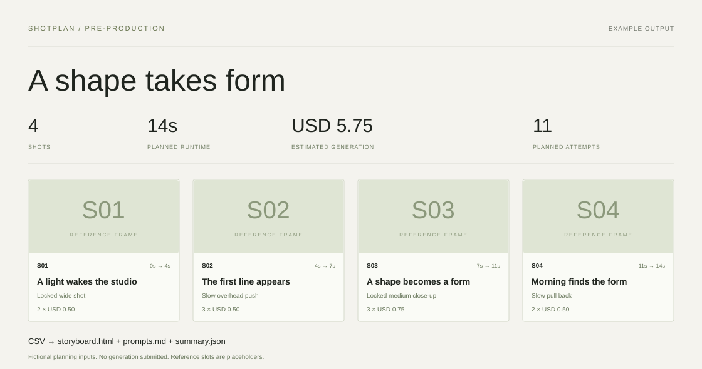

# Shotplan

**A film plan you can inspect before generating anything.** Turn a CSV shot list into an offline storyboard, a prompt pack and an exact decimal cost estimate.



## Quick start

Requires **Python 3.9+**. No packages, API keys or model access.

```sh
git clone https://github.com/satoshiwhynot/shotplan.git
cd shotplan
python3 shotplan.py examples/film.csv --title "A shape takes form" --out build
```

Open **build/storyboard.html** in your browser. Or inspect the [committed example](examples/output/storyboard.html) and [summary](examples/output/summary.json) first.

```text
4 shots · 14s · estimated USD 5.75
Open build/storyboard.html
```

## What you get

| Output | Use |
| --- | --- |
| `storyboard.html` | Printable shot cards, timeline ranges, reference frames and expandable prompts |
| `prompts.md` | One generation prompt per shot, ready for editing |
| `summary.json` | Runtime, attempts and per-shot costs for another tool |

## Edit the shot list

Start with [examples/film.csv](examples/film.csv). Save as UTF-8 CSV; quoted commas and multiline fields are supported.

| Column | Meaning |
| --- | --- |
| `shot_id` | Unique ID, e.g. `S01`; letters, numbers, `_` and `-` |
| `duration_seconds` | Positive duration in seconds |
| `description` | What the viewer sees |
| `camera` | Framing or camera movement |
| `prompt` | Editable generation instructions |
| `attempts` | Planned number of generations, 1–9999 |
| `unit_cost` | Your estimated cost for **one attempt**, not a per-second rate |
| `reference` | Optional local PNG/JPEG/WebP path, relative to the CSV |

References must stay inside the CSV directory. They are embedded in the HTML, so the output remains portable. A missing reference is a clear placeholder, not a generated frame. Limits: 200 shots, 2 MB CSV and 10 MB per reference.

```sh
python3 shotplan.py my-film.csv --title "My short film" --currency EUR --out review
```

`--currency` changes the label only. It does not convert prices. Re-running replaces the three generated files in the chosen output directory; input files remain unchanged.

## Budget assumptions

`estimated cost = sum(attempts × unit_cost)`

Example prices are fictional planning inputs. The tool does not fetch provider prices, submit jobs, spend money or measure actual generation quality. Editing, subscriptions, tax and unplanned retries are excluded. Timeline ranges assume straight cuts with no overlapping transitions.

## Check it

```sh
python3 -m unittest discover -s tests -v
```

Tests cover CSV quoting, exact decimal totals, invalid values, duplicate IDs, HTML escaping, reference boundaries and the complete compile flow. See [docs/verification.md](docs/verification.md) for release evidence.

## Files

`shotplan.py` is the complete implementation. `examples/` contains an original fictional short-film plan and its generated outputs. `tests/` documents the executable contract.

Built with AI assistance for [satoshi 001](https://x.com/satoshiwhynot). Original code and example text use the [MIT license](LICENSE). Related [production prompts](https://github.com/satoshiwhynot/practical-ai/tree/main/workflows/ai-film) cover the creative review around the plan.
